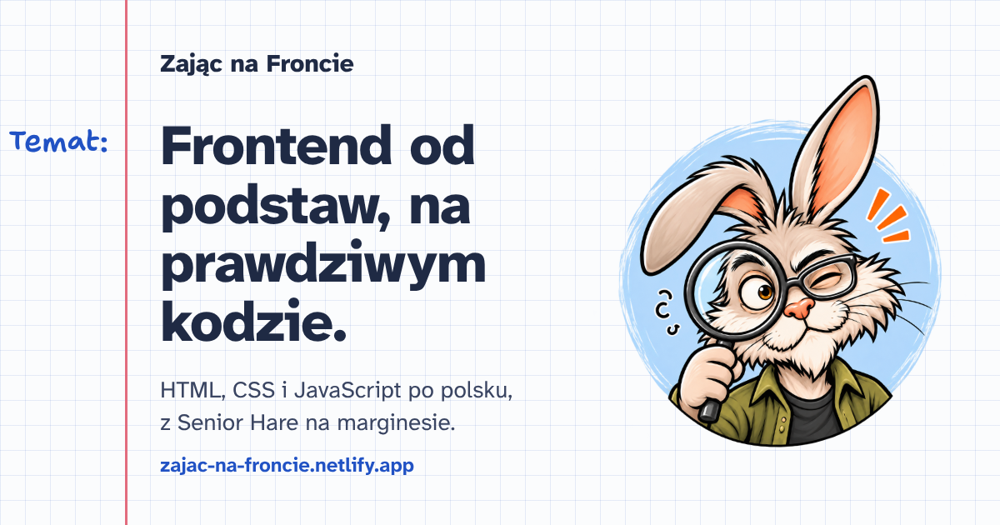

# 🐰 Zając na Froncie

> Blog o nauce frontendu dla początkujących — prowadzony przez komiksowego **Senior Hare'a**. Podstawy HTML, CSS i JavaScriptu na prawdziwym kodzie, z naciskiem na to, _jak_ się uczyć (również z pomocą AI).



🔗 **Demo na żywo:** [zajac-na-froncie.netlify.app](https://zajac-na-froncie.netlify.app)

## O projekcie

„Zając na Froncie" to blog pisany z perspektywy osoby, która uczy się frontendu od podstaw. Zamiast udawać eksperta, dokumentuję realny proces: błędy, momenty „aha", debugowanie o 3:00 i małe zwycięstwa. Przewodnikiem jest **Senior Hare** — komiksowy zając-senior, który komentuje każdy etap.

Blog jest po polsku, z myślą o polskich początkujących.

## Funkcje

- 🌗 **Tryb ciemny** z przełącznikiem — pamięta wybór (`localStorage`), startuje bez mignięcia
- 💬 **Komentarze** (Giscus / GitHub Discussions) zsynchronizowane z motywem
- 🗓️ **Zaplanowane wpisy** — pisanie „na zapas" z przyszłą datą + codzienny auto-build
- 🔍 **SEO** — tytuły i opisy per strona, Open Graph, sitemap, robots.txt
- 📊 **Analityka** — Cloudflare Web Analytics (bez ciasteczek, bez bannera)
- 🏷️ **Tagi** — klikalne tagi we wpisach, lista wszystkich tagów i strona dla każdego tagu
- 📚 **Serie wpisów** — kwadraty części pod tytułem, nawigacja poprzedni–następny i spis wszystkich serii na `/blog`
- 📓 **Wygląd zeszytu w kratkę** — margines z odręcznymi dopiskami, krótkie notatki Senior Hare'a na marginesie wpisu, kolory jako tokeny w jednym miejscu
- 📑 **Wygoda czytania** — spis treści, czas czytania, kotwice przy nagłówkach, przycisk „kopiuj” przy kodzie
- 📡 **RSS** — kanał z wpisami
- 🐰 **Komponent `<Hare>`** z 13 typami badge'y

## Stack

- **[Astro 7](https://astro.build/)** — framework, zero JS domyślnie, szybki statyczny output
- **MDX** — Markdown + komponenty w treści wpisów
- **Tailwind CSS v4** (+ plugin `@tailwindcss/typography`) — stylowanie
- **TypeScript** — bezpieczeństwo typów
- **Content Collections** — wpisy z walidacją schematu (Zod)
- **Fontsource** — Atkinson Hyperlegible Next i Mono oraz Shantell Sans (pismo Senior Hare'a)

## Uruchomienie lokalne

```
npm install      # instalacja zależności
npm run dev      # serwer deweloperski → http://localhost:4321
npm run build    # build produkcyjny → katalog dist/
npm run preview  # podgląd buildu lokalnie
```

## Struktura

```
src/
├── assets/          # grafiki optymalizowane przez Astro (badge'y, strona 404)
│   └── hare/        # 13 badge'y Senior Hare'a
├── components/      # Nav, Hare, Wiersz, Kwadraty, ListaCzesci, SeriesNav, TOC…
├── content/blog/    # wpisy w .mdx
│   ├── css-od-podstaw/  # każda seria ma swój folder (html-, js-od-podstaw/, jak-powstal-…/)
│   └── *.mdx            # pojedyncze wpisy spoza serii
├── data/            # serie.ts (opisy serii), ciekawostki.ts (dymek na stronie głównej)
├── layouts/         # Layout.astro (szkielet strony)
├── lib/             # plugin remark: czas czytania
├── pages/           # routing: index, blog, blog/[id], tags, tags/[tag], projects, about, 404, rss.xml
├── styles/          # global.css (Tailwind + motyw)
├── utils/           # posts.ts: opublikowane wpisy (filtr daty), serie, tagi
└── content.config.ts # schemat kolekcji wpisów
netlify/functions/   # scheduled-rebuild: codzienny auto-build (07:00 czasu polskiego)
```

## Jak dodać wpis

1. Utwórz plik `.mdx`:
   - pojedynczy wpis → `src/content/blog/moj-wpis.mdx`,
   - wpis z serii → do folderu serii, np. `src/content/blog/js-od-podstaw/js-od-podstaw-2-zmienne-i-typy.mdx` (nowa seria = nowy folder o nazwie z pola `series`).
2. Dodaj frontmatter zgodny ze schematem:

```
---
title: "Tytuł wpisu"
description: "Krótki opis"
pubDate: 2026-10-08
tags: ["astro", "nauka"]
draft: false
series: "nazwa-serii"    # opcjonalnie — łączy wpisy w serię
seriesPart: 1            # opcjonalnie — numer części
updatedDate: 2026-10-11  # opcjonalnie — po istotnej edycji (trafia do sitemapy)
---
```

3. Nazwa pliku = slug wpisu (adres URL). **Folder nie wchodzi do adresu**: `js-od-podstaw/js-od-podstaw-2-zmienne-i-typy.mdx` → `/blog/js-od-podstaw-2-zmienne-i-typy/`. Dlatego:
   - nazwa pliku musi być unikalna w całym `content/blog`,
   - przeniesienie wpisu do innego folderu nie psuje linków ani komentarzy (Giscus mapuje po adresie).
4. Import Hare'a zależy od głębokości pliku (patrz niżej).

> 💡 **Ukrywanie i planowanie:** `draft: true` chowa wpis. Data w **przyszłości** (`pubDate`) też go ukrywa — aż nadejdzie jej dzień, a codzienny automatyczny build opublikuje go sam.

## Komponent `<Hare>`

W treści MDX można wołać Senior Hare'a z jednym z 13 typów. Każdy ma własny badge i nagłówek. Import na początku wpisu (po frontmatterze):

```
import Hare from "../../../components/Hare.astro"; // wpis w folderze serii
import Hare from "../../components/Hare.astro";    // wpis bezpośrednio w content/blog
```

Przykład:

```
<Hare type="tip">
Najpierw spróbuj sam, dopiero potem pytaj.
</Hare>
```

Krótkie notatki bez bloku kodu (do 220 znaków) na szerokim ekranie lądują na marginesie wpisu. Dłuższe zostają komiksowym dymkiem w tekście.

| `type`     | Nagłówek                | `type`         | Nagłówek           |
| ---------- | ----------------------- | -------------- | ------------------ |
| `explain`  | Wyjaśnienie             | `works`        | Działa!            |
| `code`     | Kod                     | `debug`        | Debugowanie        |
| `tip`      | Wskazówka               | `learn`        | Nauka              |
| `bug`      | Pułapka                 | `question`     | Pytanie            |
| `why`      | Dlaczego to nie działa? | `simple`       | Proste rozwiązanie |
| `success`  | Sukces!                 | `architecture` | Architektura       |
| `decision` | Dlaczego tak?           |                |                    |

## Roadmap

**Zrobione**

- [x] Deploy na Netlify
- [x] Paleta kolorów i dopracowanie stylów
- [x] Analityka wyświetleń (prywatna, bez ciasteczek)
- [x] Tryb ciemny z przełącznikiem
- [x] Komentarze (Giscus)
- [x] Zaplanowane wpisy (filtr daty + auto-build)
- [x] Nawigacja serii / poprzedni–następny wpis
- [x] RSS feed
- [x] Czas czytania wpisu
- [x] Własna strona 404 z Senior Hare'em
- [x] SEO: lastmod w sitemapie
- [x] Kotwice przy nagłówkach
- [x] Spis treści (TOC) w wpisach
- [x] Serie wpisów w osobnych folderach (bez zmiany adresów)
- [x] Płynne przewijanie + przycisk powrotu na górę
- [x] Przycisk „kopiuj" przy blokach kodu
- [x] Nawigacja po częściach serii
- [x] Zakładka Projekty / portfolio
- [x] Klikalne tagi → strony tagów
- [x] Seria „HTML od podstaw” (8 części)
- [x] Seria „Jak powstał Destinations” i „Jak powstał Avia Weather”
- [x] Seria „CSS od podstaw” (9 części)
- [x] Redesign „zeszyt w kratkę”: nowe fonty, kolory, strona główna, spis wpisów i wpis z marginesem

**W trakcie**

- [ ] Seria „JavaScript od podstaw” (9 części opublikowanych)

**W planach**

- [ ] Kolejne serie „Jak powstał [projekt]”, na przemian z seriami podstaw

## Autor

**Paweł Zajączkowski** — [GitHub](https://github.com/TenaciousHare)

---

_Zbudowane z 🥕 i pomocą AI._
